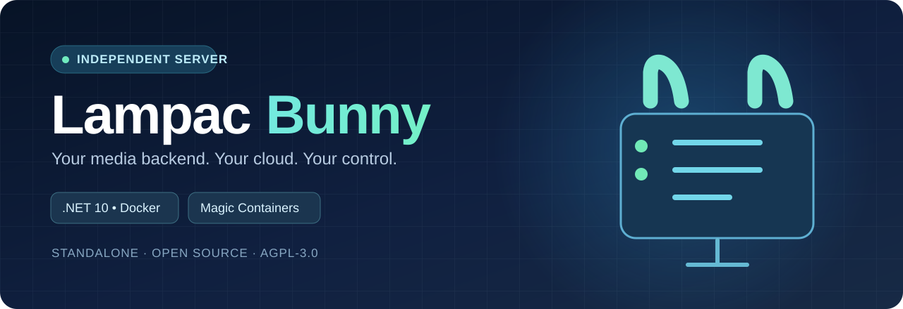

<p align="center"></p>

<h1 align="center">Lampac Bunny</h1>
<p align="center"><strong>Lampac NextGen. Your own backend. Powered by Bunny Magic Containers.</strong></p>
<p align="center">A self-hosted, independent Lampac NextGen deployment for Bunny — with a source-based Docker build, a guarded startup configuration, persistent volume support and clear multilingual guides.</p>

<p align="center">
  <a href="bunny/docs/DEPLOY.en.md">English</a> ·
  <a href="bunny/docs/DEPLOY.ru.md">Русский</a> ·
  <a href="bunny/docs/DEPLOY.nl.md">Nederlands</a> ·
  <a href="https://docs.lampac.dev/">Original Lampac documentation</a>
</p>

<p align="center">
  
  
  
  
  
</p>

> [!IMPORTANT]
> **Independent project.** Lampac Bunny does not import, build, depend on or change **Lampa Multilingual Edition**. You may use it with any compatible Lampa client or its native API. This repository is a full fork of [Lampac NextGen](https://github.com/lampac-nextgen/lampac), not an empty Docker wrapper.

> [!WARNING]
> **Source preview, not a certified live deployment.** The Bunny adapter can be tested locally; physical media playback, provider availability, persistent-volume restore and production deployment require real acceptance. A public CDN endpoint is not an authentication boundary.

## One-command deploy to Bunny Magic Containers

**No Docker, SSH, GitHub account, or local build required for users.** Install from a terminal:

```bash
curl -fsSL https://raw.githubusercontent.com/vbrekher/lampac-bunny/main/bunny/scripts/install-bunny.sh | bash
```

Paste your **bunny.net account API Key** at the hidden prompt (Bunny Dashboard → Account → API). The installer never sends the key anywhere other than Bunny's API or saves it. It checks the public GHCR image digest, reuses or creates your GHCR registry, picks an available EU region (NL first), creates **one** shared runtime instance, **one** 5 GB persistent database volume, an HTTPS CDN endpoint on container port **9118**, a unique root password and readiness checks, then deploys. It checks both `/version?type=hash` and `/online.js` before reporting success.

**Public GHCR required:** GitHub Packages → `lampac-bunny` → Package settings → Change visibility → Public. A private package cannot be pulled with only a Bunny key. The installer checks this **before** creating billable resources.

**Billing / security:** Bunny Magic Containers, volumes and CDN are paid resources; your account must allow provisioning. The CDN endpoint is public; restrict access and review admin/API exposure before sharing it. The generated root password is saved only on your machine at `~/.config/lampac-bunny/deployment.json` (mode 0600). No Bunny API Key is stored. Re-running will reuse a matching app, not create duplicates. Set a specific region by running the installer from a checkout with `--region DE`.

Deployment is **not yet live-certified** until a user completes real Bunny acceptance. See [Русский](bunny/docs/DEPLOY.ru.md), [English](bunny/docs/DEPLOY.en.md), [Nederlands](bunny/docs/DEPLOY.nl.md).

## What is included?

| Feature | What Lampac Bunny adds |
| --- | --- |
| **Full Lampac core** | Existing .NET 10 application and modules preserved, compiled from this fork's source |
| **Bunny container build** | Lightweight, source-built `bunny/Dockerfile` for `linux/amd64`, retaining the original `Dockerfile` |
| **Secure boot** | Required 16+ character root secret, config validation, non-root upstream runtime, no default password |
| **Persistent data** | Separate mount paths for SQLite (`/lampac/database`) and cache (`/lampac/cache`) |
| **Client integration** | Native `/online.js` plugin and HTTP API; compatible clients connect independently |
| **Optional modules** | TorrServer, JacRed, Sync and TimeCode remain in source but start disabled; Chromium/GStreamer/FFmpeg tools are absent from the LIGHT image |
| **Operations** | Bootstrap preflight, endpoint smoke script, local Compose and RU/EN/NL deployment guides |

## How it works

```text
Any compatible client  ──HTTPS──>  Bunny CDN endpoint
                                          │
                                 Bunny Magic Containers
                                  Lampac .NET / :9118
                                          │
                                SQLite volume + cache volume
```

**Bunny Database is not a drop-in replacement** for Lampac's SQLite. This edition deliberately leaves database migration out of its first release rather than claiming unsupported integration. Edge Scripting is not required to run Lampac.

## Docker Desktop storage recovery

The reported `metadata_v2.db: read-only file system`, NuGet write failure and `dpkg: Input/output error` mean **Docker Desktop's Linux VM could not write to its disk**. Restore host/VM disk health before rebuilding; this cannot be repaired by a source-code change alone.

Run `bash bunny/scripts/doctor.sh` (read-only), restart Docker Desktop, and check **Settings → Resources → Advanced** for the disk image size. You may optionally remove **unused** builder cache with interactive `docker builder prune` after Docker is writable. Do **not** blindly reset Docker or run `docker system prune --volumes`.

**New default: LIGHT source build** using official .NET 10 SDK/runtime images. It intentionally excludes Chromium, GStreamer and FFmpeg: the starter config disables those modules. Full multimedia tools require a separate image and real validation. Details: [Русский](bunny/docs/DEPLOY.ru.md) · [English](bunny/docs/DEPLOY.en.md) · [Nederlands](bunny/docs/DEPLOY.nl.md).

## Quick start

```bash
git clone https://github.com/vbrekher/lampac-bunny.git
cd lampac-bunny
bash bunny/scripts/doctor.sh
bash bunny/scripts/preflight.sh
# Build a full linux/amd64 Docker image from this repository:
bash bunny/scripts/build-image.sh ghcr.io/vbrekher/lampac-bunny:v0.1.1 --load
```

For local testing, set a strong password and use the fail-closed local acceptance script (a failed build will **not** misleadingly report completion):

```bash
export LAMPAC_ROOT_PASSWORD="$(openssl rand -hex 24)"
bash bunny/scripts/local-acceptance.sh
```

The image runs as the built-in non-root `app` user supplied by the .NET 10 base, avoiding Ubuntu's existing GID 1000. The script retries transient HTTP startup failures (including curl 52), verifies a nonempty HTTP 200 response and shows container state/logs on persistent failure. To verify an **already built** local image without recompiling .NET, run `bash bunny/scripts/local-acceptance.sh --no-build`.

To publish to your own GHCR after authentication:

```bash
bash bunny/scripts/build-image.sh ghcr.io/vbrekher/lampac-bunny:v0.1.1 --push
```

Then create a **Bunny Magic Containers** application using that image, a **CDN endpoint on port 9118**, one replica/region, the required `LAMPAC_ROOT_PASSWORD` variable and a persistent volume mounted to `/lampac/database`.

<details>
<summary><strong>Show full deployment checklist</strong></summary>

1. Build and publish the `linux/amd64` image; do not assume a GitHub commit automatically publishes a container.
2. Add image from GHCR to Bunny Magic Containers (connect private registry if needed).
3. Set endpoint port **9118**; the external URL should be HTTPS.
4. Mount `/lampac/database`, optionally `/lampac/cache`; avoid multiple replicas or regions for SQLite.
5. Set a unique secret under `LAMPAC_ROOT_PASSWORD` (16+ characters).
6. Add startup/readiness/liveness checks on `/version?type=hash` port 9118.
7. Configure authentication, route restrictions, firewall/rate limits *before* public usage.
8. Deploy, inspect logs, then run `bash bunny/scripts/smoke.sh https://YOUR-ENDPOINT`.
9. Validate restart persistence, actual client/API behavior and media provider permissions separately.

</details>

## Documentation

| Language | Deployment guide |
| --- | --- |
| English | [Deploy to Bunny (EN)](bunny/docs/DEPLOY.en.md) |
| Русский | [Установка на Bunny (RU)](bunny/docs/DEPLOY.ru.md) |
| Nederlands | [Installeren op Bunny (NL)](bunny/docs/DEPLOY.nl.md) |

Additional: [Architecture](bunny/docs/ARCHITECTURE.md) · [Security](bunny/docs/SECURITY.md) · [Official Bunny deployment](https://bunny.net/docs/magic-containers/deploy) · [Persistent Volumes](https://bunny.net/docs/magic-containers/persistent-volumes) · [Original Lampac documentation](https://docs.lampac.dev/).

## Important limitations

- **One instance, one region:** Bunny persistent volumes are pod-specific and are not automatically replicated/backed up. Always perform backup-and-restore drills before enabling Sync or TimeCode.
- **Not a torrent hosting guarantee:** P2P networking, multicast/DLNA and inbound protocols require real compatibility checks on Bunny's sandbox.
- **Not a content subscription:** the project ships software, not films or access rights. Provider integrations can fail or require authorization.
- **No unattended public proxy:** built-in online endpoints may need separate WAF, authentication and rate limiting; the adapter does not provide a universal API authentication gateway.
- **No automatic image publish or account deployment:** the operator controls their registry and Bunny account.

## Credits & license

**A sincere thank-you to the creators and contributors of [Lampac NextGen](https://github.com/lampac-nextgen/lampac)** for the media backend and to the original Lampa developers for the compatible client ecosystem. Lampac Bunny is an independent community-maintained deployment variant and is **not affiliated with Bunny.net or the upstream Lampac team**.

The original Lampac source remains licensed under **[AGPL-3.0](LICENSE)**. Preserve upstream notices and source-availability obligations when running modified network services. If you use the Bunny deployment layer, check upstream licenses and provider terms before publishing.
